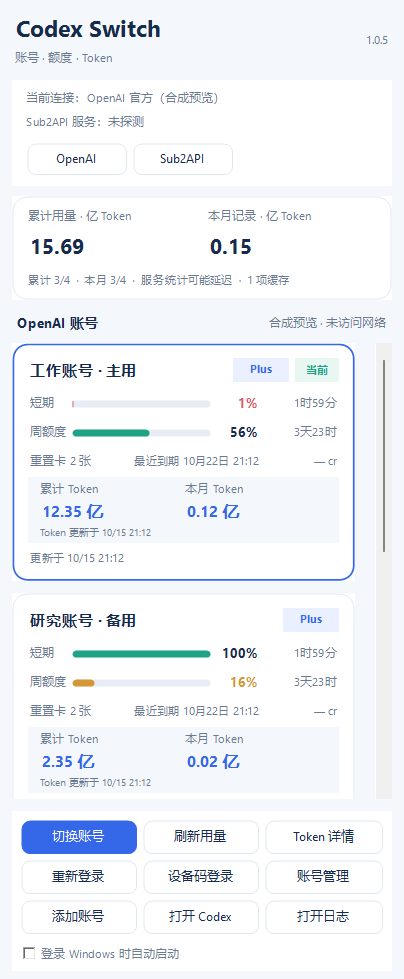

# Codex Switch

**macOS 最新版：[v2.3.3 下载与更新说明](https://github.com/ld017/codex-switch/releases/tag/v2.3.3)**（Apple Silicon；ad-hoc 签名，未公证）。

**Windows 最新版：[1.0.6 安装包与免安装版](https://github.com/ld017/codex-switch/releases/tag/windows-v1.0.6)**（Windows 10/11 x64，自带 .NET 8 运行时）。[Windows 更新说明](docs/releases/windows-v1.0.6.md)。



上图仅使用合成账号和合成用量数据展示 Windows 布局。macOS 2.3.3 将连接诊断收进可展开入口，详见[发布说明](docs/releases/v2.3.3.md)。

`Codex Switch` 是一个 macOS 菜单栏工具和 Windows 桌面面板应用，用于统一管理两类独立状态：

- Codex provider：`OpenAI` / `Sub2API`
- OpenAI 账号：多账号登录、切换和逐账号剩余额度监控，包括可用重置卡数量和最近一张的到期时间

它同时保留原 Codex Provider Switcher 的共享任务/项目代理，所有 provider 继续共用 `~/.codex` 中的任务、历史、项目、插件和设置。

## 行为边界

- provider 切换只修改 `~/.codex/config.toml` 顶层的 `model_provider`，并保留原子写入、备份、验证和失败回滚。
- OpenAI 账号切换只在当前 provider 为 `OpenAI` 时执行，避免一次操作同时改写 provider 与登录态。
- 额度刷新在临时 `CODEX_HOME` 内运行，其中的 `model_provider` 强制设为 `openai`。因此即使桌面 Codex 当前连接 Sub2API，也不会用 Sub2API 数据冒充 OpenAI 账号额度。
- Codex 返回的是已用百分比；菜单栏图标、账号卡片数字和进度条统一换算为剩余百分比。剩余不高于 `30%` 时警告，不高于 `10%` 时显示为紧急。
- 重置卡使用 `rateLimitResetCredits.availableCount` 作为可用数量；到期时间取所有 `available` 卡中最早的 `expiresAt`，用本机时区显示为“最近到期”。macOS兼容明细缺省/null，仅知道数量时不推断到期时间。
- 累计 Token 使用官方 `account/usage/read` 返回的 `summary.lifetimeTokens`，不是从额度百分比换算。各账号卡片显示累计值，“Token 用量详情”提供精确值、读取时间和服务端返回的每日记录。统计可能延迟，缺项不视为零，也不代表普通 ChatGPT 聊天或 Sub2API 的用量。
- Token 合计按已保存的账号身份去重，未知身份和没有累计值的账号不计入，并显示未计入数量。查询失败可保留旧值并标记缓存；Token 接口不可用不会使已取得的额度数据失效。
- 本月按本机当前自然月匹配官方日期桶，仅汇总已返回记录，统一用“亿 Token”；每日明细用“百万 Token”，均保留两位小数。未返回本月记录的账号显示未获取，合计标注部分覆盖；小于显示精度的正数用 `<0.01`，避免误显示为零。
- 切换 provider 或 OpenAI 账号都会重启 Codex，菜单会在操作前明确警告当前任务将中断。

## macOS 刷新与资源

额度到达后立即展示，查询CLI单并发并优先当前账号；完整Token统计15分钟内复用，手动刷新可重新获取。共享历史代理采用线性分行和分段对象释放。[总体架构](docs/architecture/refresh-and-resources.md) · [验收与基准](docs/performance/2026-10-18/verification.md)。

## 账号数据

上游发布版使用其开发者签名授权的 Data Protection Keychain access group。本机集成版无法合法复用该私有 entitlement，因此按上游的 source-build 安全路径使用：

- 配置和缓存：`~/.codex-switcher/`
- 账号凭据：`~/.codex-switcher/dev-auth-store/`
- 目录权限：`0700`
- 凭据文件权限：`0600`

菜单、日志和调试输出不显示认证令牌；Token 用量只显示数量。

## 构建与安装

### Windows 10/11 x64

Windows 版使用 .NET 8 WinForms，安装包自带运行时，并提供开始菜单和可选开机启动。详细说明见 [windows/README.md](windows/README.md)。

```powershell
dotnet test windows/CodexSwitch.sln -c Release
powershell -ExecutionPolicy Bypass -File windows/scripts/build-installer.ps1
```

### macOS

```bash
swift test
scripts/build-and-install.sh
```

发布可下载安装包时使用独立打包脚本（需要 Python 3）：

```bash
scripts/package-macos-release.sh
```

产物位于 `.build/releases/<版本>/`。脚本映射编译路径、去除调试信息并重新签名，随后检查应用和 ZIP 中的个人主目录路径、常见个人邮箱、凭据候选与运行态数据文件；检查失败会中止本轮打包，同版本旧文件不会自动删除。发布时仅上传本轮成功产物并核对SHA-256。定向拦截不能代替人工审查。已有安装使用的应用标识继续保留以兼容登录项与凭据存储。

安装脚本默认使用 ad-hoc 签名。如需使用本机已安装的代码签名身份，显式传入：

```bash
CODEX_SWITCH_SIGNING_IDENTITY="Apple Development: Your Name (TEAMID)" \
  scripts/build-and-install.sh
```

安装位置是 `~/Applications/Codex Switch.app`。升级时会把原 `Codex Provider Switcher.app` 移入 `~/.codex/provider-switcher/app-backups/`，保留可恢复性。

Bundle ID `com.lindui017.codex-provider-switcher` 和 `codex-switcher://` URL Scheme 刻意保持不变，以兼容原登录启动项和切换脚本。

## 上游来源

多账号、隔离登录、配额读取、账号切换和凭据保护逻辑基于 [4LAU/codex-profile-switcher](https://github.com/4LAU/codex-profile-switcher) commit `4f2f313b5156be84341f21ce43a73b501ff5dc3a`（v0.5.21），按 MIT License 使用。许可证见 `LICENSE.codex-profile-switcher`。
