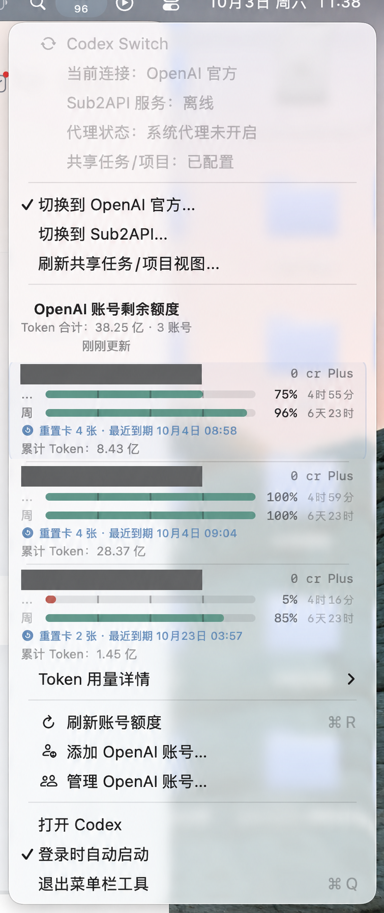

# Codex Switch 2.3.1（macOS）

本次更新为 macOS 菜单栏增加官方 Codex Token 统计，并修复登录后图标位置不易找到的问题。

## 更新内容

- 各账号卡片显示累计 Token 和本月已返回用量，顶部提供按账号身份去重的合计及覆盖数。
- 本月用量统一以“亿 Token”显示；每日明细以“百万 Token”显示，保留两位小数。
- “Token 用量详情”提供累计精确值、读取时间、每日记录和本月数据截至日期。
- 缺失数据不视为零；部分覆盖、缓存和刷新失败均有提示。
- 额度图标和进度条显示剩余额度；Token 查询失败不丢弃成功获取的额度数据。
- 菜单栏项目使用稳定的位置标识；账户查询等待时间放宽至 15 秒。

## 下载与安装

下载 `Codex-Switch-2.3.1-macOS-arm64.zip`，解压后将 `Codex Switch.app` 放入 `~/Applications/`，再打开应用。更新前先退出已有的 Codex Switch。

- 适用：Apple Silicon Mac，应用声明最低 macOS 14；本次在 macOS 26 上验证。
- 安装包使用 ad-hoc 签名，未经过 Apple 公证；macOS 可能提示无法验证开发者。请按系统提示通过“隐私与安全性”允许打开，或从源码自行构建。
- 安装包不包含账号凭据、配置、使用记录或本机签名证书。已有账号数据保存在用户目录中。
- `SHA256SUMS.txt` 提供附件校验值。
- 本次 Release 附件仅提供 macOS 版本；仓库中的 Windows 实现继续保留。

## 统计口径

Token 统计来自官方 `account/usage/read`，属于 Codex 活动统计，不代表普通 ChatGPT 聊天、Sub2API 或所有渠道的总消耗。服务端可能延迟返回数据。

“本月”按本机当前自然月匹配服务端日期桶，只汇总已返回记录。没有本月记录时显示“未获取”；合计缺少账号时标记“部分”。日期桶沿用服务端日期，不推定其时区。

## 截图

上图来自 2.3.0 实际使用截图，经图像工具遮盖全部账号邮箱；展示累计 Token 菜单布局。2.3.1 已新增本月统计与覆盖提示，实际界面以新版应用为准。

## 验证

- 74 项 Swift Testing 核心测试通过。
- 5 项 Token 显示逻辑 XCTest 通过，覆盖月份边界、重复记录去重、单位格式和缺失值。
- 三个不同账号的累计 Token 接口已完成本机读取验证。
- Release 构建和安装包代码签名完整性检查通过；未在其他型号 Mac 上验证。
